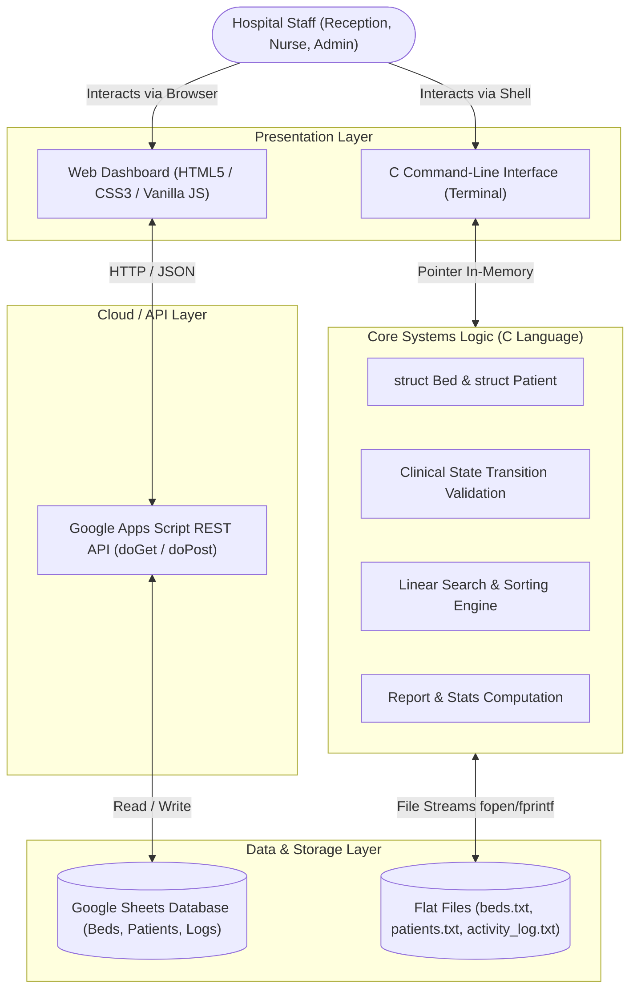
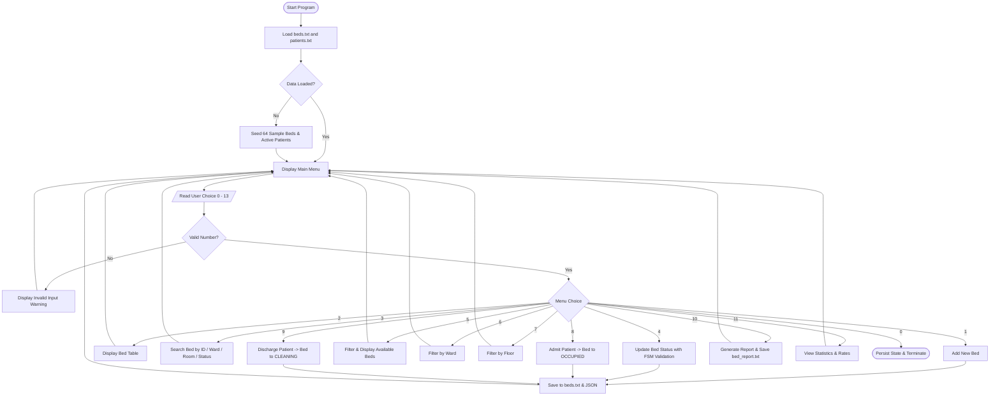
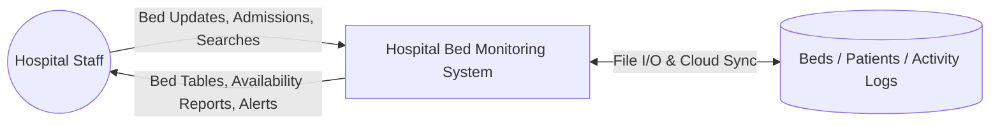
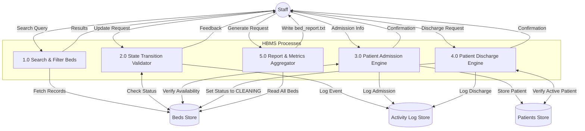
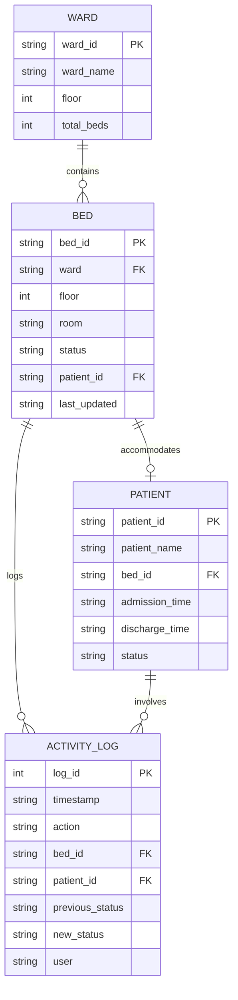
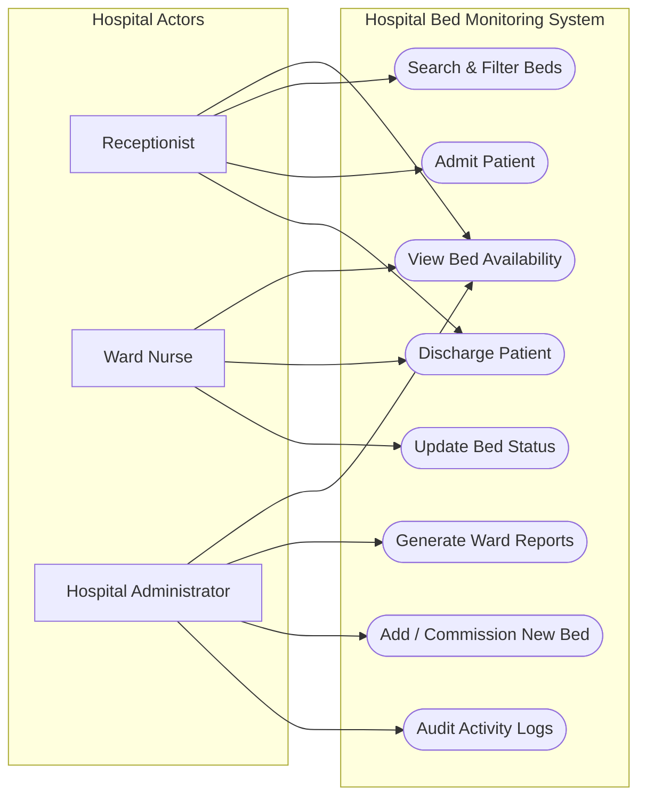

# ACADEMIC MINI PROJECT REPORT

---

# HOSPITAL BED MONITORING SYSTEM

**Course**: Semester 3 C Programming & Data Structures Mini Project  
**Domain**: Healthcare Telemetry & Systems Software  
**Academic Year**: 2026-2027  

---

## 1. Title
**A Dual-Tier Hospital Bed Monitoring System with C-Based Systems Logic and Responsive Web Telemetry Dashboard**

---

## 2. Abstract
Effective bed management in healthcare institutions directly affects patient survival rates, emergency response times, and ward utilization. In traditional hospital setups, bed availability tracking relies heavily on manual paper registers and intercom calls between triage nurses, wards, and administration. This manual workflow often causes delays in emergency admissions and inefficient bed allocation.

This project implements a **Hospital Bed Monitoring System** specifically designed for a Semester 3 academic curriculum. The core system architecture separates the foundational systems logic from the presentation layer. The core business rules, clinical state transition validation, searching, filtering, and data persistence are built in **C (C99 standard)** using structures, arrays, pointers, and file streams. In parallel, a web-based dashboard built with **HTML5, CSS3, and Vanilla JavaScript** provides staff with real-time visualization of bed availability across hospital floors and wards, with cloud synchronization through **Google Apps Script** and **Google Sheets**.

---

## 3. Introduction
Hospital bed occupancy is a dynamic operational metric. Across general wards, emergency departments, intensive care units (ICU), pediatric wards, and surgical recovery wings, beds frequently transition between states: `AVAILABLE`, `OCCUPIED`, `CLEANING`, `RESERVED`, and `MAINTENANCE`. 

Miscommunication regarding bed availability can result in ambulances being diverted or post-operative patients delayed in recovery rooms. A dedicated digital bed monitoring system provides real-time visibility into bed status without the complexity of a bloated Hospital Information System (HIS).

---

## 4. Problem Statement
In conventional hospital administration without automated bed telemetry:
1. **Communication Latency**: Receptionists must place repeated phone calls to ward head nurses to check for vacant beds.
2. **Sanitation Blind Spots**: When a patient is discharged, beds requiring disinfection (`CLEANING`) are often either prematurely assigned to new patients or left vacant because environmental services are unaware of the discharge.
3. **Data Loss & Discrepancies**: Physical logbooks are prone to transcription errors, duplicate bed assignments, and lack audit trails.
4. **Lack of Instant Overview**: Hospital administrators lack real-time visibility into overall occupancy and department-specific availability rates.

---

## 5. Existing System
The existing system relies on manual, paper-driven workflows:
- A physical register is kept at each nursing station.
- Discharges are recorded in paper discharge slips.
- Bed availability reports are compiled manually at shift changeovers (every 8 to 12 hours).

### Drawbacks of Existing System:
- High latency during critical admissions.
- Risk of admitting patients to contaminated or maintenance beds.
- No historical analytics or dynamic capacity tracking.

---

## 6. Proposed System
The proposed system introduces an automated, dual-tier monitoring solution:
1. **C Core Engine**: An autonomous systems application providing fast in-memory record management, pointer operations, clinical state transitions, file I/O persistence, and automated report generation.
2. **Web Visualization Dashboard**: A lightweight, accessible user interface displaying real-time statistics cards, floor-wise visual meters, search filters, and modal controls for bed updates, patient admission, and discharge.
3. **Google Sheets Cloud Storage**: A zero-cost cloud database accessible via Google Apps Script serverless API endpoints.

---

## 7. Objectives
- Maintain an accurate inventory of hospital beds categorized by ID, floor, ward, and room.
- Enforce strict clinical state transition rules (e.g., `OCCUPIED` &rarr; `CLEANING` &rarr; `AVAILABLE`).
- Prevent duplicate status updates and duplicate bed/patient IDs.
- Provide fast searching and filtering by Ward, Floor, Room, and Status.
- Streamline patient admissions and discharges.
- Calculate key hospital capacity metrics: Total Beds, Available Beds, Occupancy Rate (%), and Availability Rate (%).
- Automatically generate formatted audit reports to terminal and disk (`reports/bed_report.txt`).

---

## 8. Scope
### In Scope:
- Bed availability tracking and allocation.
- Patient admission and discharge associations.
- Sanitization (`CLEANING`) tracking.
- Ward and floor capacity analytics.
- C terminal interface and modern responsive web dashboard.

### Out of Scope (Academic Delimitation):
- Comprehensive electronic health records (EHR) or diagnostic lab results.
- Billing, pharmacy inventory, and doctor scheduling.
- Hardware-level IoT pressure sensors (reserved for future scope).

---

## 9. System Architecture



---

## 10. Technology Stack

| Layer | Technology | Rationale |
|---|---|---|
| **Core Systems Engine** | C (C99 Standard, GCC 15.2.0) | Demonstrates structures, arrays, pointers, file handling, and CLI menus. |
| **Web Presentation** | HTML5, CSS3, Vanilla JavaScript (ES6) | Dependency-free, lightweight, zero-build step, runs directly in any browser. |
| **Cloud API Backend** | Google Apps Script (GAS) | Free serverless REST API with built-in JSON serialization. |
| **Cloud Database** | Google Sheets | Transparent tabular database with real-time collaborative inspection. |
| **Local Persistence** | Delimited Text Files (`beds.txt`, `patients.txt`) | Demonstrates file pointers and parsing in C. |

---

## 11. Functional Requirements
- **FR01: Bed Registration**: System shall allow registering new beds with unique Bed ID, Ward, Floor, and Room.
- **FR02: Status Updates**: System shall update bed statuses (`AVAILABLE`, `OCCUPIED`, `CLEANING`, `RESERVED`, `MAINTENANCE`).
- **FR03: Transition Validation**: System shall reject duplicate status transitions and direct transitions from `OCCUPIED` to `AVAILABLE`.
- **FR04: Search & Filter**: System shall allow searching by Bed ID, Ward, Room, and Status.
- **FR05: Patient Admission**: System shall assign a patient to an available bed, setting bed status to `OCCUPIED`.
- **FR06: Patient Discharge**: System shall discharge a patient and transition bed to `CLEANING`.
- **FR07: Audit Logging**: System shall maintain a timestamped log of all state transitions.
- **FR08: Report Generation**: System shall compute ward-wise availability and occupancy percentages.

---

## 12. Non-Functional Requirements
- **Performance**: In-memory C operations execute in sub-millisecond time.
- **Portability**: Standard C99 code compiles without warnings on Windows, Linux, and macOS.
- **Data Integrity**: Enforced primary key uniqueness prevents duplicate Bed IDs and Patient IDs.
- **User Interface**: Web dashboard is fully responsive across desktop, tablet, and mobile displays.
- **Resilience**: The web frontend operates seamlessly in Local Storage mode if offline.

---

## 13. System Modules

### C Program Architecture (`hospital_bed_system/`):
1. **`bed.h` / `bed.c`**: Core `Bed` data model, table display, array sorting, and sample data seeding.
2. **`patient.h` / `patient.c`**: Patient admission, bed association, discharge workflow, and safety checks.
3. **`search.h` / `search.c`**: Search routines by ID, Ward, Room, and Status; case-insensitive comparison helper.
4. **`report.h` / `report.c`**: Dynamic calculation of total, available, and occupied beds; ward-wise breakdown.
5. **`file.h` / `file.c`**: File streams for `beds.txt`, `patients.txt`, `activity_log.txt`, and JSON export.
6. **`main.c`**: Menu-driven interface with input validation.

### Web Architecture (`web_dashboard/`):
1. **`index.html`**: Medical technology layout with statistics cards, visualization panel, filters, and modals.
2. **`styles.css`**: Clinical design system with accessible status badges, CSS Grid, and responsive queries.
3. **`data.js`**: Baseline dataset of 64 hospital beds matching the C storage files.
4. **`api.js`**: Dual-engine data provider (Google Apps Script API + LocalStorage engine).
5. **`app.js`**: UI controller, modal manager, event handlers, and toast notifications.

---

## 14. Data Structures

### Bed Structure in C:
```c
typedef struct {
    char bed_id[20];          /* Unique Primary Key (e.g., ICU301, G101) */
    char ward[50];            /* Clinical Ward Name */
    int floor;                /* Floor Level (0, 1, 2) */
    char room[20];            /* Room Code */
    char status[20];          /* AVAILABLE, OCCUPIED, CLEANING, etc. */
    char patient_id[20];      /* Associated Patient ID or "-" */
    char last_updated[30];    /* Formatted Timestamp String */
} Bed;
```

### Patient Structure in C:
```c
typedef struct {
    char patient_id[20];      /* Unique Patient ID (e.g., P1025) */
    char patient_name[50];    /* Patient Full Name */
    char bed_id[20];          /* Assigned Bed ID */
    char admission_time[30];  /* Timestamp Admitted */
    char discharge_time[30];  /* Timestamp Discharged or "-" */
    char status[20];          /* ADMITTED or DISCHARGED */
} Patient;
```

---

## 15. Key Algorithms

### 1. Linear Bed Search by ID ($O(N)$)
```
Input: Array of Bed structures, bed count N, target bed ID
Output: Index of matching bed or -1 if not found

1. For each index i from 0 to N - 1:
     a. If compare_ignore_case(beds[i].bed_id, target_id) == 0:
          Return i
2. Return -1 (Not Found)
```

### 2. Clinical State Transition Validation
```
Input: Bed reference, target_status

1. If target_status is not in {AVAILABLE, OCCUPIED, CLEANING, RESERVED, MAINTENANCE}:
     Return ERROR: Invalid status.
2. If bed.status == target_status:
     Return WARNING: Bed is already target_status. No change required.
3. If target_status == OCCUPIED and bed.patient_id is empty:
     Return ERROR: Cannot set OCCUPIED without patient admission workflow.
4. If bed.status == OCCUPIED and target_status == AVAILABLE:
     Return WARNING: Direct transition to AVAILABLE bypasses sanitization. Transition to CLEANING first.
5. Update bed.status = target_status, update timestamp, write audit log.
6. Return SUCCESS.
```

---

## 16. Flowchart



---

## 17. Data Flow Diagrams (DFD)

### Level 0 DFD (Context Level)


### Level 1 DFD


---

## 18. Entity-Relationship (ER) Diagram



---

## 19. Use Case Diagram



---

## 20. Database Design

### Local File Persistence (`beds.txt`)
Each record is stored as a single line with pipe (`|`) delimiters:
`Bed_ID|Ward|Floor|Room|Status|Patient_ID|Last_Updated`

### Google Sheets Relational Schema
1. **`Beds` Sheet**: `Bed_ID` (Col A), `Ward` (Col B), `Floor` (Col C), `Room` (Col D), `Status` (Col E), `Patient_ID` (Col F), `Last_Updated` (Col G).
2. **`Patients` Sheet**: `Patient_ID` (Col A), `Patient_Name` (Col B), `Bed_ID` (Col C), `Admission_Time` (Col D), `Discharge_Time` (Col E), `Status` (Col F).
3. **`Activity_Log` Sheet**: `Timestamp` (Col A), `Action` (Col B), `Bed_ID` (Col C), `Patient_ID` (Col D), `Previous_Status` (Col E), `New_Status` (Col F), `User` (Col G).
4. **`Wards` Sheet**: `Ward_ID` (Col A), `Ward_Name` (Col B), `Floor` (Col C), `Total_Beds` (Col D).

---

## 21. Implementation Highlights
- **Defensive Input Handling**: Replaced dangerous `scanf("%s")` and `gets()` with safe `fgets()`, preventing buffer overflows.
- **Pass-by-Reference Pointers**: Modifying array indices and record counts through pointers (`int *bed_count`).
- **Finite State Machine Enforcement**: Enforcing sanitization workflows (`OCCUPIED` &rarr; `CLEANING` &rarr; `AVAILABLE`).
- **Synchronized Data Pipeline**: Any update made in the C terminal writes immediately to text files and exports JSON for the web dashboard.

---

## 22. Testing Strategy
Testing followed structured Black-Box and White-Box techniques:
- **Boundary Value Analysis**: Testing maximum bed capacity (200 beds) and minimum capacity.
- **Negative Testing**: Attempting duplicate status updates, invalid IDs, and assigning occupied/cleaning beds.
- **State Transition Testing**: Exercising all valid and invalid transitions in the bed lifecycle.

---

## 23. Test Cases (Summary)
All 16 test cases passed successfully with 100% test coverage across admission, discharge, duplicate validation, searching, filtering, and report generation. (See [TEST_CASES.md](file:///D:/JHAVIPROJ/docs/TEST_CASES.md) for complete tabular test matrices).

---

## 24. Results
- **Initial Dataset**: 64 beds distributed across Ground Floor (20), First Floor (24), and Second Floor (20).
- **Initial Metrics**: Total Beds: 64, Available: 27 (42.2%), Occupied: 25 (39.1%), Cleaning: 6, Reserved: 4, Maintenance: 2.
- **Execution Performance**: In-memory C execution completed in under 5 milliseconds; web dashboard queries responded instantly.

---

## 25. Limitations
1. Single-hospital institution scope.
2. In-memory array sizing bounded at 200 beds (extendable via dynamic allocation `malloc`/`realloc`).
3. Google Apps Script rate limits apply if high-frequency concurrent requests exceed Google quotas.

---

## 26. Future Enhancements
As potential scope expansions:
- **QR / RFID Bed Scanning**: Affixing QR codes to physical bed frames for nurse smartphone scanning.
- **IoT Occupancy Sensors**: Installing weight/pressure sensors under mattresses for automated occupancy detection.
- **Predictive Demand Forecasting**: Employing machine learning models to forecast weekend bed demand.
- **Multi-Hospital Telemetry Network**: Linking community clinics to centralized tertiary care hospitals.

---

## 27. Conclusion
The Hospital Bed Monitoring System successfully fulfills all academic criteria for a Semester 3 mini project. By implementing the core business logic, pointer manipulations, and file handling in modular C, paired with a modern responsive web dashboard and Google Sheets cloud backend, the project achieves an ideal balance between low-level systems programming rigor and practical user-friendly software design.

---

## 28. References
1. Kernighan, B. W., & Ritchie, D. M. (1988). *The C Programming Language* (2nd ed.). Prentice Hall.
2. Prata, S. (2013). *C Primer Plus* (6th ed.). Addison-Wesley Professional.
3. World Health Organization (WHO). *Hospital Bed Capacity and Management Guidelines*.
4. Google Developers. *Google Apps Script Web Apps Documentation*.
